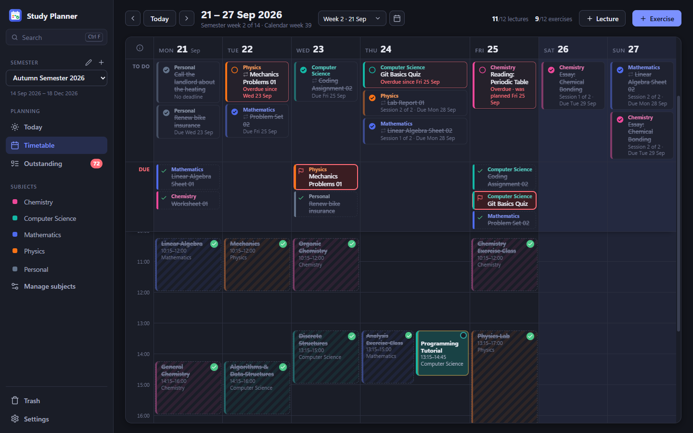
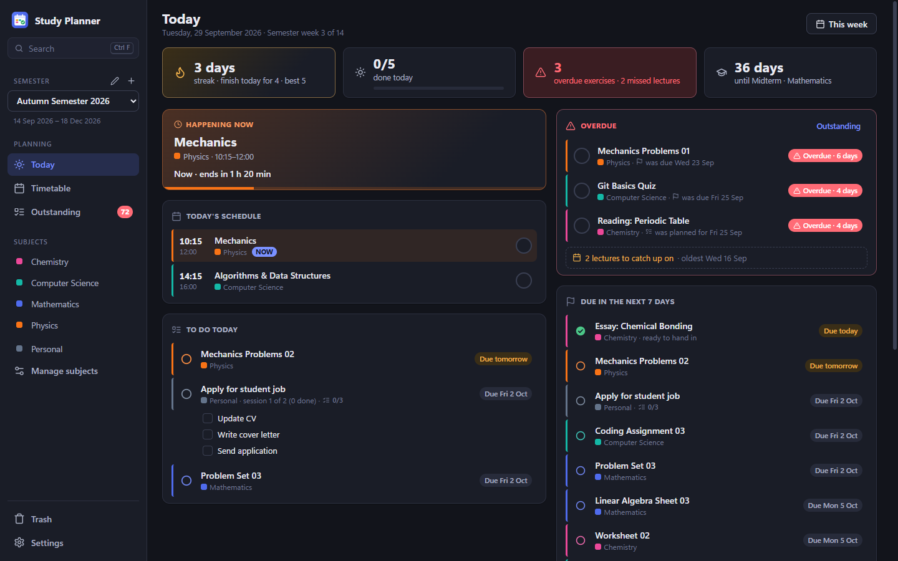
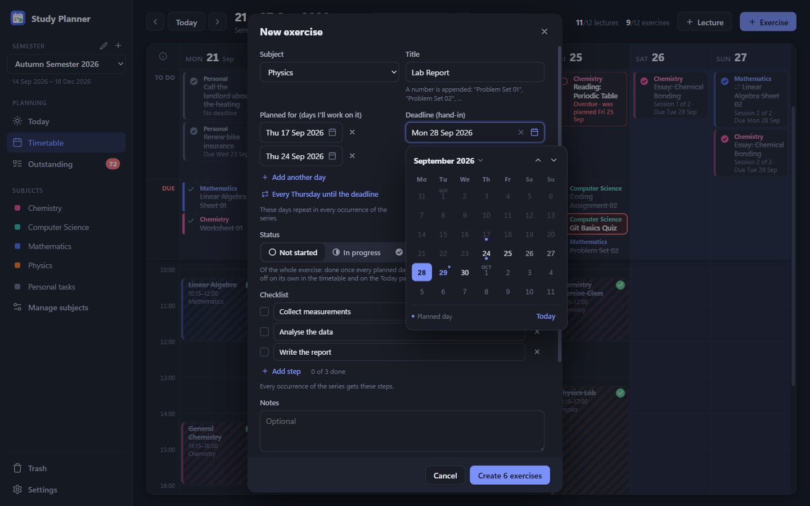
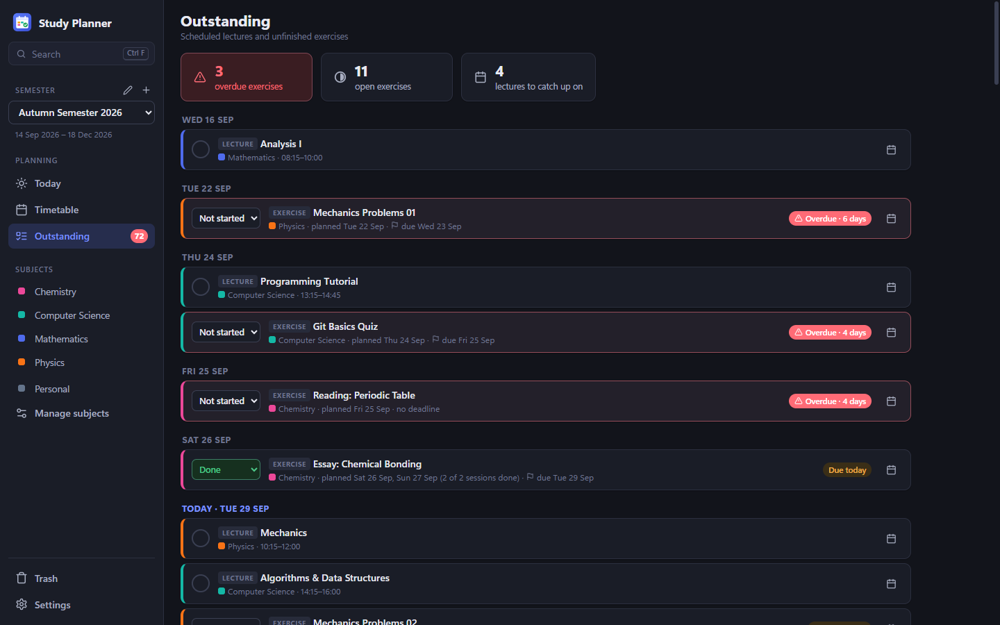
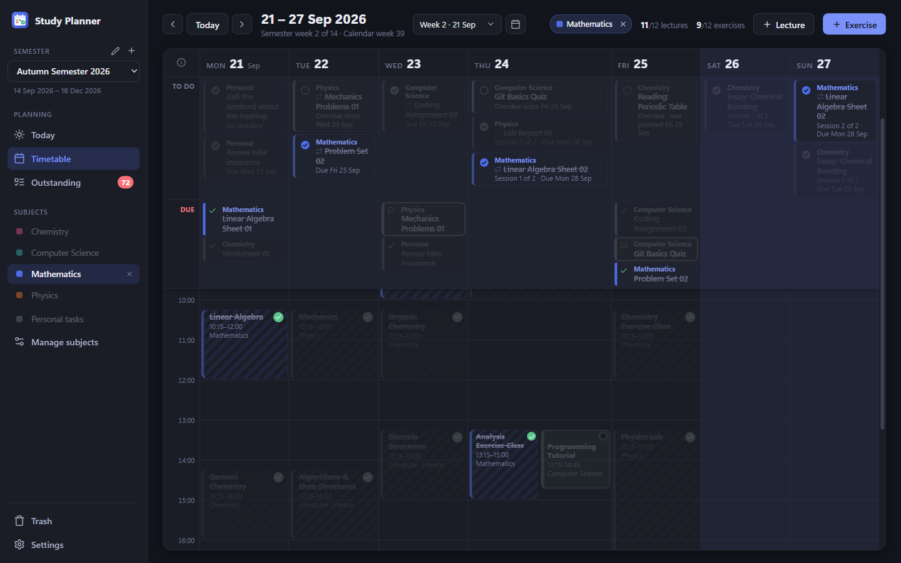
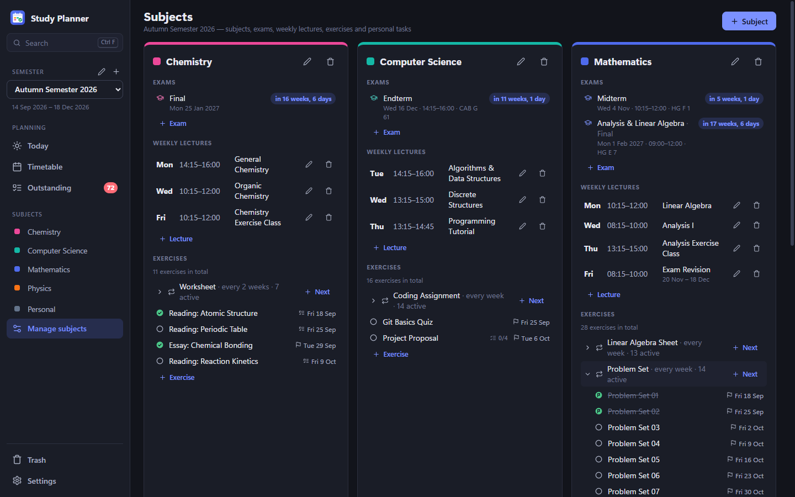
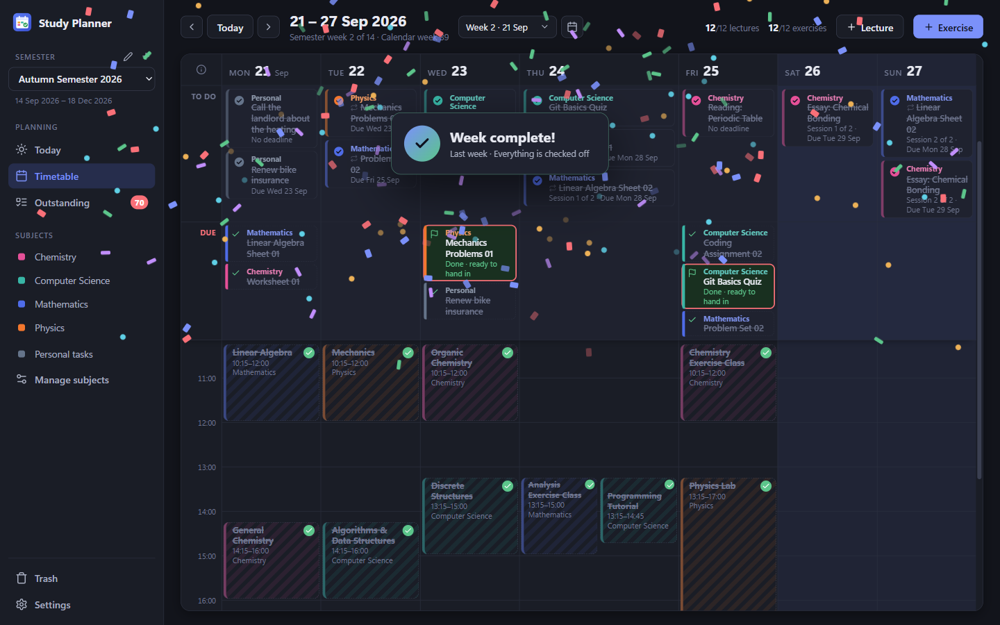

<div align="center">


# Study Planner

**Plan your university semester around a visual weekly timetable.**<br>
Track which lectures you've completed, plan when you'll work on each exercise, and never lose sight of a deadline.

Windows desktop app · works fully offline · your data stays on your PC



</div>

## Features

- **Your whole week on one screen.** Lectures, the days you've planned to work on each exercise, deadlines and exams, all in one timetable. 
- **Plan the work, not just the deadline.** Pick the days you'll actually sit down for each exercise and check off every session as you go. Break the big ones into steps. Finishing an exercise and handing it in are separate, so nothing drops off your list before it's submitted. A whole series (`Problem Set 01`, `02`, …) is set up in one go.
- **Start every day knowing what matters.** The Today page shows what's on right now, what's next, what to get done today and what's coming up this week, with a streak for every day you finish everything.
- **Nothing slips through.** Missed lectures and unfinished exercises pile up in one Outstanding list until you deal with them, and every exam counts down.
- **Built around your actual semester.** Courses that start late or end early, autumn breaks and public holidays: lectures only show up when they really take place.
- **Zoom in on one subject.** Click a subject and everything else fades out, so you can see where you stand in it.
- **Checking things off feels good.** A soft ding for every lecture and exercise, confetti when your week is done.
- **Your data stays yours.** Everything lives offline on your PC, with daily backups, a trash bin for anything you delete, and updates that install themselves without touching your data.

## Screenshots



| Plan recurring exercises with checklists | See what's still open |
|---|---|
|  |  |

| Focus on one subject | Manage your subjects |
|---|---|
|  |  |



## Installation

1. Download `Study-Planner-Setup-<version>.exe` from the [Releases](../../releases) page.
2. Run the installer. It installs for your user account and adds a desktop and Start-menu shortcut.

The installer isn't code-signed, so Windows SmartScreen may show a warning the first time. Choose **More info → Run anyway**.

From version 1.10.0 on, the app updates itself: it checks GitHub for a new version when it starts, downloads it in the background and installs it when you close the app (or right away via **Settings → Updates → Restart & update**). Older versions update by installing the newer version over them once. Your data is kept either way.

## Your data

Everything is stored locally in a SQLite database in `%APPDATA%\StudyPlanner\`, separate from the program itself. There's no account and no cloud, and no internet connection is needed (except to look for updates).

- A backup is saved automatically once a day (the last 14 are kept) and before every database upgrade.
- **Settings → Data & backups** in the app shows the exact location and can create a backup on demand.
- To restore a backup, close the app, copy the backup file over `study-planner.db`, and delete any `study-planner.db-wal` and `study-planner.db-shm` files next to it.

## Building from source

Requires Windows and [Node.js](https://nodejs.org) 22 or newer.

```sh
npm install
npm run dev      # run the app with live reload (uses a separate development data folder)
npm test         # run the tests
npm run dist     # build the installer into release/
```

Built with Electron, React, TypeScript and SQLite. [CLAUDE.md](CLAUDE.md) describes the architecture, data model and the rules for changing the database; [CHANGELOG.md](CHANGELOG.md) lists what changed in each version.

## License

[MIT](LICENSE) © 2026 Silvan Meier
